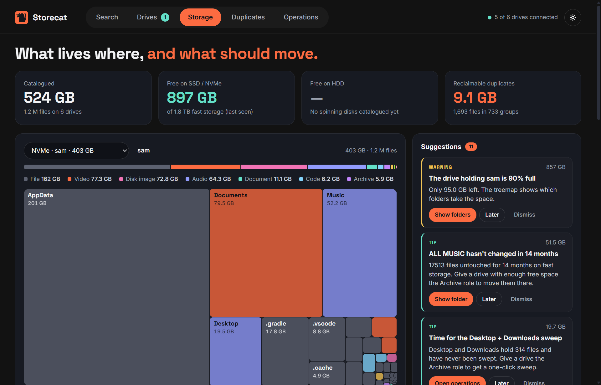

# Storecat

**Search first. Plug in second.**

Storecat is a fast, local-only catalogue of every drive you own. Plug a drive in once
and it records every file's name, path, size, dates, type-specific metadata, a thumbnail,
extracted document text and a quick hash. From then on you can search all of it instantly
whether the drive is connected or not.

Built for people with a shelf full of external drives and no idea which one holds the
file they need.

> Status: **0.9.0, release candidate for 1.0.** Everything in [the user guide](docs/guide.md)
> works on Windows. macOS and Linux builds come from CI; their drive detection is
> implemented but has had far less real-world use. See [CHANGELOG.md](CHANGELOG.md) for what changed.



## Features

**Find**
- Catalogue any drive, folder, network share or disc; the catalogue survives drive-letter
  changes and stays searchable when the drive is unplugged
- Search as you type across every drive in milliseconds, with filters: `ext:pdf`
  `kind:video` `size:>1gb` `modified:2023` `drive:seagate` `is:dir` `path:clients`
  `content:unpaid` `tag:client-x`
- Thumbnails, photo/audio/video/document metadata and document text, visible offline
- Files inside zip, 7z, tar and ISO disc images, searchable without extracting
- Silent rescan when a known drive is plugged back in; enrichment resumes where it stopped
- Easy on spinning hard drives: files are read in the order they sit on the disk
- Tags, saved searches, a photo per drive, and a Ctrl+Shift+Space quick-search palette

**Understand**
- Drive profiles: SSD, NVMe or spinning disk, connection type, model and health
- A treemap per drive, coloured by content type, with drill-down
- Duplicate detection across drives, verified with full BLAKE3 hashes on demand
- Suggestions: rescue copies for failing drives, nearly-full drives, cold folders that
  should leave the SSD, Desktop + Downloads sweeps, duplicates, folders catalogued twice

**Act**
- Copy and move jobs that hash every file, verify the copy, and only then delete originals;
  journaled per file, so a job resumes after a pause, a crash or an unplugged drive
- Every suggestion opens as a job you review and start; nothing moves on its own
- Duplicate cleanup that keeps the copy you choose and recycles the rest

**Stay private**
- Everything is local. The only network requests are the optional FFmpeg download and the
  daily update check, which you can turn off
- Logs and crash reports stay on disk

## Install

Download the installer from [GitHub Releases](https://github.com/samcarmex/storecat/releases),
or on Windows:

```bash
winget install Storecat.Storecat
```

## Tech

- [Tauri v2](https://v2.tauri.app/) shell, Rust core, Svelte 5 + TypeScript UI
- SQLite catalogue per drive, one [Tantivy](https://github.com/quickwit-oss/tantivy) index across all drives
- BLAKE3 hashing, JPEG thumbnails

## Building from source

Prerequisites: Rust (stable, via rustup), Node 20+, and on Windows the Visual Studio
C++ build tools and WebView2 (preinstalled on Windows 11).

```bash
npm install
npm run tauri dev
```

```bash
npm run tauri build
```

The installer lands in `target/release/bundle/`.

### Command line

The same engine is available as `storecat` (`cargo build --release -p storecat-cli`):

```bash
storecat volumes
```

```bash
storecat scan E:\
```

```bash
storecat search "invoice ext:pdf modified:2023"
```

```bash
storecat tree 3 Videos
```

```bash
storecat suggest
```

```bash
storecat sweep E:\ --dry-run
```

```bash
storecat backup "E:\Archive\2026-11 client files" "C:\Users\me\Documents\Clients" --move
```

Data lives in `%LOCALAPPDATA%\io.storecat.app` on Windows (override with `STORECAT_DATA_DIR`).
Releasing is described in [RELEASING.md](RELEASING.md).

## Repository layout

```
crates/core        OS-agnostic library: catalogue, scanner, search, operations
crates/platform    per-OS: volume identity, drive type, bus, model and health
crates/extract     metadata, thumbnails, text extraction
crates/cli         command-line interface over core
apps/desktop       Tauri shell + Svelte UI
docs/              user guide and project website (GitHub Pages)
packaging/         installer artwork and winget manifests
```

## Licence

GPL-3.0-or-later. See [LICENSE](LICENSE).
